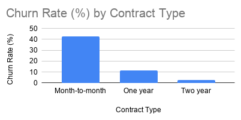
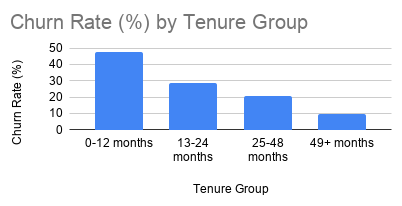
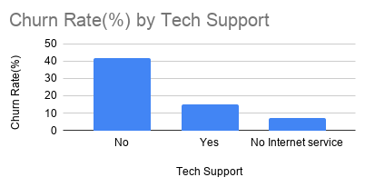

# Customer Churn Analysis

Analysis of 7,043 customer records to identify factors associated with customer churn, using SQL for data extraction and segmentation and Google Sheets for visualization.

## Objective

Identify the factors most associated with customer churn and suggest data-backed ideas to reduce customer loss.

## Data & Method

- **Dataset:** IBM Telco Customer Churn sample dataset (7,043 customer records, 21 columns)
- **Tools:** SQL (data extraction, filtering, segmentation) → Google Sheets (pivot analysis, visualization)
- **Overall churn rate:** 26.54% (1,869 of 7,043 customers)

All SQL queries used in this analysis are available in [`sql_queries.sql`](./sql_queries.sql).

## Key Findings

### 1. Contract Type



| Contract Type | Total Customers | Churn Rate |
|---|---|---|
| Month-to-month | 3,875 | **42.71%** |
| One year | 1,473 | 11.27% |
| Two year | 1,695 | 2.83% |

Month-to-month customers churn at roughly **15x the rate** of two-year contract holders, the widest gap among the three factors analysed.

### 2. Customer Tenure



| Tenure Group | Total Customers | Churn Rate |
|---|---|---|
| 0-12 months | 2,186 | **47.44%** |
| 13-24 months | 1,024 | 28.71% |
| 25-48 months | 1,594 | 20.39% |
| 49+ months | 2,239 | 9.51% |

Churn declines steadily with tenure. Customers in their first 12 months churn about **5x more often** than customers with 49+ months of tenure, which may point to gaps in onboarding or early-experience retention.

### 3. Tech Support Access



| Tech Support | Total Customers | Churn Rate |
|---|---|---|
| No | 3,473 | **41.64%** |
| Yes | 2,044 | 15.17% |
| No internet service | 1,526 | 7.40% |

Customers without tech support churn at about **2.7x the rate** of those with it, which may suggest that unresolved technical issues contribute to churn.

## Recommendations

These are ideas suggested by the patterns above, not tested conclusions.

- **Incentivize longer-term contracts** (e.g., a modest discount for annual/two-year plans) to reduce the pool of high-risk month-to-month customers.
- **Strengthen onboarding in the first 12 months** (check-ins, tutorials, proactive support) to address the steep early-tenure churn.
- **Promote or bundle tech support at signup**, particularly for new and month-to-month customers, to reduce friction-driven churn.

## Limitations

- This is a descriptive analysis: it shows which groups churn more, not what causes churn.
- The factors overlap (for example, month-to-month customers are more likely to be new), so each finding should not be read in isolation.

## Repo Structure

```
customer-churn-analysis/
├── README.md
├── sql_queries.sql
└── charts/
    ├── contract_type_churn.png
    ├── tenure_group_churn.png
    └── tech_support_churn.png
```
